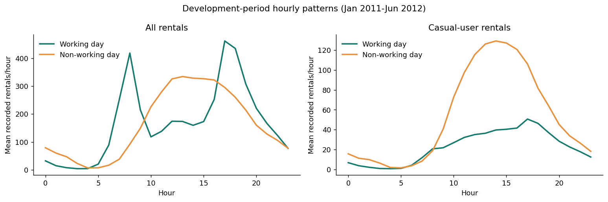
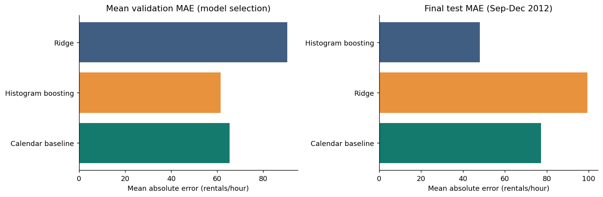

# Bike-Sharing Demand Analysis

A complete, reproducible response to the supplied bike-sharing case study: data audit, demand exploration, one statistical hypothesis, time-ordered rental forecasting, and a local operations prototype with natural-language questions.

**Question:** customers cannot find bikes while other bikes sit unused. Should the company buy more?

**Recommendation:** forecast rental activity to prioritize operational checks, then measure station availability and test redistribution. Aggregate completed-rental counts cannot establish the number of bikes to purchase.



## Detailed Report

[Read the detailed project report](https://drive.google.com/file/d/1YIqrBXFbac3QYx7WEVPCZQqhlXu9FPve/view)

## Start here

1. Read the executed [analysis notebook](notebooks/bike_demand_analysis.ipynb).
2. Read the generated [final findings](reports/findings.md).
3. Run the Streamlit app to explore scenarios and ask questions.

## Results on the supplied data

Training ends June 2012. July-August calibrates intervals. September-December is the final holdout, not used for selection. Three earlier expanding windows select the model by mean validation MAE.

| Model | Final test MAE (rentals/hour) | RMSE | WAPE |
|---|---:|---:|---:|
| Recent calendar baseline | 77.24 | 124.20 | 32.15% |
| Ridge regression | 99.45 | 134.97 | 41.40% |
| Histogram gradient boosting | **47.99** | **72.91** | **19.97%** |

The selected boosting model reduces test MAE **37.9%** relative to the baseline. Nominal 90% hourly intervals achieve **89.4%** held-out coverage. Mean bias is **-33.7 rentals/hour**, so underprediction remains an operational risk. No classification-style accuracy claim is made.

The morning-share hypothesis finds an adjusted **15.26 percentage-point** greater 07:00-09:59 share on working days (95% CI 14.42-16.10), with month-year controls and week-clustered standard errors. This is an observational association, not proof of causality.

Audit: **17,379** hourly records, **731** daily records, **3,292,679** completed rentals; no blank cells or duplicate time keys. **165 missing hourly slots** are left missing, not assumed zero. Hourly totals reconcile to daily totals for all three rental count columns.



## Setup and run

Tested with Python 3.12; Python 3.12 or 3.13 is recommended. Start a terminal in this repository. Internet is needed once to install packages; subsequent analysis and app use local files with no API keys.

### Windows PowerShell

```powershell
py -3.12 -m venv .venv
.\.venv\Scripts\python.exe -m pip install -e ".[dev]"
.\.venv\Scripts\python.exe -m bike_demand.pipeline
.\.venv\Scripts\python.exe -m streamlit run app.py
```

If Python 3.12 is not installed, use a supported installed Python with `python -m venv .venv` for the first command. Activation is not required with the commands above.

### macOS / Linux

```bash
python3 -m venv .venv
source .venv/bin/activate
python -m pip install -e '.[dev]'
python -m bike_demand.pipeline
python -m streamlit run app.py
```

Open the local URL shown by Streamlit (normally `http://localhost:8501`). This repository contains a local app; no public website deployment is implied. If the local model is absent, the app trains it on first launch. Model serialization is intentionally ignored by Git: reproduce it from source and do not load untrusted pickle/joblib files.

### Jupyter / VS Code

Open `notebooks/bike_demand_analysis.ipynb`, select the project `.venv` Python kernel, and run all cells. Outputs are already included for review. If your Jupyter installation cannot see the environment:

```bash
python -m ipykernel install --user --name bike-demand --display-name "Python (bike-demand)"
```

Run that command using the project environment's Python. Regenerate and execute the notebook programmatically with:

```bash
python scripts/build_notebook.py --execute
```

For restricted hosts where a separate kernel server cannot start, `--in-process` runs every cell sequentially through IPython and saves outputs. The delivered notebook was verified this way; a separate TCP Jupyter kernel could not start in the build environment. On your laptop the normal notebook/kernel workflow applies.

## Operations prototype

- Select a historical holdout date, weather category, temperature, apparent temperature, humidity, wind, and holiday status.
- Inspect 24 hourly rental estimates with nominal uncertainty bands, peak periods, and downloadable CSV.
- Set explicit trip-duration, turnaround, and usable-fleet assumptions. Inspect the workload scenario and sensitivity.
- Review actual held-out errors, data checks, patterns, and the hypothesis.
- Ask: **"What are the peak hours?"**, **"What is the daily total?"**, **"How many rentals at 8 am?"**, **"Compare historical working days and weekends"**, or **"How many bikes under these capacity assumptions?"**

The natural-language interface is a **bounded rule-based prototype**, not an LLM chatbot. It computes answers from the current scenario and source data; unsupported questions receive a limitation. It does not execute arbitrary SQL/code, infer station stockouts, or generate live 2026 predictions. No external services or API keys are required.

## What “bikes needed” means here

The model forecasts recorded rental starts. A separate transparent approximation illustrates assumed capacity:

`average bicycle workload ≈ rentals/hour × (trip + turnaround minutes) / 60 / usable fraction`

Round up for the displayed scenario. This is a steady-state flow/cycle-time calculation; it is not exact simultaneous occupancy, a station stock-flow simulation, or a purchase recommendation. Durations and usable fractions are assumptions. There is no evidence here on station availability, existing fleet, trip returns, failed rental attempts or unmet demand. A bike can serve multiple trips within one hour. The upper rental band can stress a scenario but is not a guaranteed fleet requirement.

## Methodology and important assumptions

- Both CSVs are fully used: `hour.csv` for analysis/modeling and `day.csv` for exact rental-component reconciliation, daily trends, and cross-checks. They summarize the same trips and are not stacked together.
- Raw files are retained. Missing hours stay missing; zero-humidity records are flagged, not arbitrarily overwritten. Extreme counts are not automatically deleted.
- Calendar dates show season codes 1/2/3/4 correspond to winter/spring/summer/autumn, despite the README's shifted names. Preserve the codes and document the mismatch.
- Inputs: hour, weekday, month, season, holiday/workday, weather category and scaled weather; elapsed time and cyclic hour/year features. Exclude `cnt`, `casual`, `registered`, and record index. No unavailable future target lags.
- All preprocessing is fit only on each training window. Boosting uses a non-negative Poisson objective; Ridge output is clipped at zero.
- Candidate settings are fixed. Selection folds: Jan-Feb, Mar-Apr, May-Jun 2012. Final training ends June 30. Calibration: July-August. Test: September-December.
- Model errors use **observed** weather. Operational future use requires forecast weather, whose error impact is not measured. Scenario weather is hypothetical and constant across 24 hours. Feels-like temperature is editable; it defaults to air temperature only as an approximation in the scenario API.
- Severe weather (code 4) has three hourly rows in the entire dataset; its predictions are unreliable. Two years also limit evidence about long-term growth.
- Absolute-residual split calibration targets nominal 90% **marginal hourly** coverage. Seasonal drift/serial dependence violate exchangeability. Report actual coverage and subgroups; do not add hourly bands as a daily confidence interval.
- The frozen model underpredicts some later demand; production use would require recent training, rolling monitoring, and prospective validation.

## Files and generated outputs

| Path | Contents |
|---|---|
| `data/raw/` | Supplied `hour.csv`, `day.csv`, README, and case-study PDF |
| `notebooks/bike_demand_analysis.ipynb` | Executed walkthrough: assumptions, code, charts, results, recommendations |
| `src/bike_demand/` | Reusable audit, hypothesis, modeling, scenarios, report generation |
| `app.py` | Streamlit operations prototype |
| `reports/findings.md` | Final submission-ready findings and proposed field experiment |
| `reports/cross_validation.csv` | Candidate scores across chronological validation folds |
| `reports/test_metrics.csv` | All candidates' final held-out metrics |
| `reports/test_predictions.csv` | Recorded/predicted rentals, intervals, errors, peak flags |
| `reports/error_segments.csv` | Errors/coverage by hour, workday, weather, commute peak |
| `reports/hypothesis.json` | Hypothesis, method, effect, interval, p-value, limitations |
| `reports/hypothesis_daily_data.csv` | Auditable complete-day morning shares |
| `reports/data_quality.json`, `missing_hours.csv` | Audit results and explicit absent-hour list |
| `reports/feature_importance.csv` | Calibration-period permutation importance |
| `reports/capacity_sensitivity.csv` | Explicit workload assumptions and sensitivity |
| `reports/reproducibility.json` | Input SHA-256 hashes and tested library versions |
| `reports/figures/` | Six generated figures |
| `tests/` | Data leakage/integrity, date boundaries, scenario units, query behavior, app interactions |

## Validation

```bash
python -m pytest -q
python -m bike_demand.pipeline
```

Tests include deliberately corrupted counts, leakage invariance, chronological boundaries, unseen holiday fallback, capacity units/invalid assumptions, bounded date scope, calculated/refused natural-language answers, and Streamlit control interactions. The notebook has been executed end to end. GitHub Actions reproduces the analysis and uploads reports as a workflow artifact.

## Interview talking points

- **Why not buy bikes immediately?** Completed counts cannot distinguish fleet scarcity from poor distribution or quantify failed demand.
- **Why not a random split?** Predicting later periods should be evaluated on later dates; random splits blur temporal growth and seasonality.
- **Why not use casual/registered counts?** They sum exactly to the target and reveal the answer.
- **Why keep a baseline?** ML must demonstrate improvement against a practical simpler forecast.
- **Why not an LLM?** The required prototype can answer a useful bounded set of questions reliably with deterministic calculations. An optional LLM could translate more varied wording into the same validated functions, but is not needed to run this submission.
- **What would improve it most?** Recent station-level stock/return/unserved-demand data, prospective weather forecasts, cost data, and a measured redistribution experiment.

## Source attribution

Dataset: Capital Bikeshare, Washington, D.C., 2011-2012, supplied with the case study. Original dataset README is included unchanged. Its requested citation is:

Hadi Fanaee-T and Joao Gama, **Event labeling combining ensemble detectors and background knowledge**, Progress in Artificial Intelligence (2013), DOI: [10.1007/s13748-013-0040-3](https://doi.org/10.1007/s13748-013-0040-3).

The README does not provide an explicit software-style dataset license; none is inferred. Case-study requirements are in `data/raw/case_study.pdf`.
